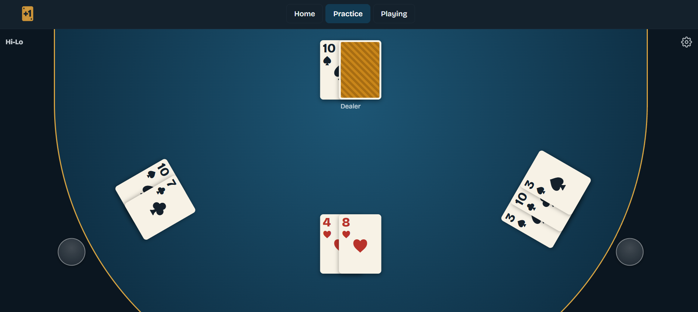

# +1 — Card Counting Trainer

A browser-based trainer for learning card counting and practicing it at a blackjack table. Explore different counting systems, test your running count as cards are dealt, or play blackjack with a virtual bankroll.



## Features

- **Home:** an introduction to card counting and an interactive guide to each system’s card values.
- **Practice:** follow a timed deal across multiple hands, enter the running count, and check your answer before the dealer’s hidden card is revealed.
- **Playing:** play blackjack with Hit / Stand, $1 / $5 / $10 bets, and a starting virtual balance of $25.
- **Settings:** choose a counting system, adjust the number of decks and practice deal speed, show the running count, reshuffle, or reset your balance.
- **Counting systems:** Hi-Lo, Hi-Opt I, Hi-Opt II, KO, Omega II, Red 7, Halves, Zen Count, and 10 Count.
- Light and dark styles based on your system preference.

The app runs entirely in the browser. There are no accounts, backend services, or real-money transactions. Settings, statistics, and balance reset when you reload the page.

## Tools and libraries

| Tool | Purpose |
| --- | --- |
| [React](https://react.dev/) + React DOM | Components, shared settings, and interactive screens |
| [TypeScript](https://www.typescriptlang.org/) | Typed application and game logic |
| [Vite](https://vite.dev/) + React plugin | Development server, hot updates, and production builds |
| [Vitest](https://vitest.dev/) | Unit tests for the card-counting and blackjack engine |
| [ESLint](https://eslint.org/) | TypeScript, React Hooks, and React Refresh lint checks |
| [Oxlint](https://oxc.rs/docs/guide/usage/linter.html) | Additional fast lint checks |

Styling uses plain CSS, and navigation uses URL hashes—no UI kit, routing package, or state-management library is required.

## Getting started

### Requirements

- **Node.js 24 LTS recommended**, with npm installed.
- A modern web browser.

### Install and run

Clone or download the repository, then open a terminal in its root directory:

```bash
npm ci
npm run dev
```

Open the local URL printed by Vite, usually **http://localhost:5173**.

### Try it out

1. Open **Home** to explore the counting systems.
2. Use the **gear menu** to select the system and deal speed you want to practice.
3. Open **Practice**, click **Deal round**, and track every face-up card. Enter your count and click **Check**; the dealer’s hidden card counts only when revealed.
4. Switch to **Playing** to practice counting while making blackjack decisions.

## Available commands

| Command | Description |
| --- | --- |
| `npm run dev` | Start the development server |
| `npm test` | Run the engine tests once |
| `npm run lint` | Run Oxlint followed by ESLint |
| `npm run lint:oxlint` | Run only Oxlint |
| `npm run lint:eslint` | Run only ESLint |
| `npm run build` | Type-check the project and build it into `dist/` |
| `npm run preview` | Serve the existing production build locally |

To build and preview the production version:

```bash
npm run build
npm run preview
```

The generated `dist/` directory can be deployed to a static web host. No application server is needed.

## Project structure

```text
public/res/       Logos, favicon, and README screenshot
src/
├── components/   Reusable cards, hands, settings dialog, and indicators
├── engine/       Card shoes, counting systems, blackjack rules, and tests
├── hooks/        Hash-based navigation
├── pages/        Home, Practice, and Playing screens
├── settings/     Shared settings context and provider
├── App.tsx       App shell and navigation
├── main.tsx      React entry point
└── index.css     Global styles and themes
```

The engine is independent of React and browser APIs, so its rules can be tested separately from the interface.

## License

[MIT](LICENSE).
